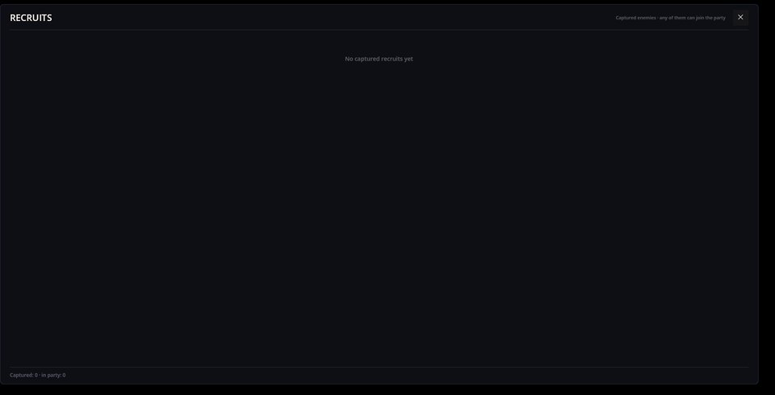

# Recruiting — 加入队伍的被击败敌人

Recruiting 让战斗中被击败的敌人可以被俘获，之后在玩家一方作战。胜利之后，每个被击败的敌人都有一定几率被俘获；被俘的角色会列在**招募者**面板里，任何一个都可以加入队伍或再次移出。被俘期间，招募者按自己的规则生活——在 Cthangover 里，它会饿肚子。

本模组不依赖任何战斗系统：它监听平台的“角色被击败”事件，因此无论 FF Battle、Card Battle 还是其他任何会报告被击败角色的系统都能配合。谁能被俘获、需要什么条件，由游戏的数据和其他模组决定。

## 招募者面板

通过工具栏按钮打开。Cthangover 开局时还没有俘获任何人：



每个被俘的招募者占一行，显示头像、名字和生命，并带一个按钮：**加入队伍**或**移出队伍**。底部统计招募者总数以及其中多少人在队伍里。

## 俘获是如何发生的

胜利之后，对每个被击败的敌人：

1. 敌人的角色文件里 `RecruitmentChance` 必须大于 0。
2. 每种敌人只能有一个招募者：如果该类型已被俘获，就跳过。
3. 每个已注册的**条件**都必须允许。本模组自带一个：玩家必须拥有 `slave_master` 技能（在 Cthangover 里马劳从一开始就有）。
4. 一次 1 到 100 的掷骰不能超过几率。

通过之后，敌人以 10 点生命加入名册。在 Cthangover 中，唯一能被俘获的角色要到剧情后期才会遇到，几率为 50%：

```json
{ "Id": "werewolf_girl_1", "RecruitmentChance": 50 }
```

## 在队伍中

**加入队伍**会把招募者变成普通的队伍成员：它出现在角色面板上，用自己的动作参加战斗，可以成为物品的目标，并随队伍一起存档。战斗中损失的生命记在招募者身上。**移出队伍**会为它保留动作和经验，下次加入时还在。

## 招募者的需求

每个招募者都会在游戏时钟的每次走针时运行已注册的**行为**。本模组自带一个——进食：24 个游戏小时没吃东西的招募者，每走针损失 1 点生命。在当前游戏里还没有任何东西能喂招募者，所以被俘的招募者会在被俘一天后开始挨饿。

名册、生命和行为状态都会随游戏一起保存。

## 给模组作者

- **条件**是实现 `IRecruitCondition` 的类；recruiting 模组会在任何已加载的模组里找到它。返回 false 即可禁止俘获。
- **行为**实现 `IRecruitBehaviour`：在招募者被俘获时配置，每次走针时调用，并随招募者一起移除。它的状态保存在招募者的属性里。
- 代码可以响应 `RecruitJoinedEvent` 和 `RecruitLeftEvent`。

## 出问题了怎么办

1. **从来没人被俘获。** 敌人的 `RecruitmentChance` 是 0、某个条件不答应（玩家缺少 `slave_master` 技能），或者掷骰没过。
2. **同一个敌人不会被俘获两次。** 每种敌人一个招募者，这是有意设计的。
3. **招募者的生命一直掉。** 那是进食机制：它一天没吃东西了，而目前还没有办法喂它。
